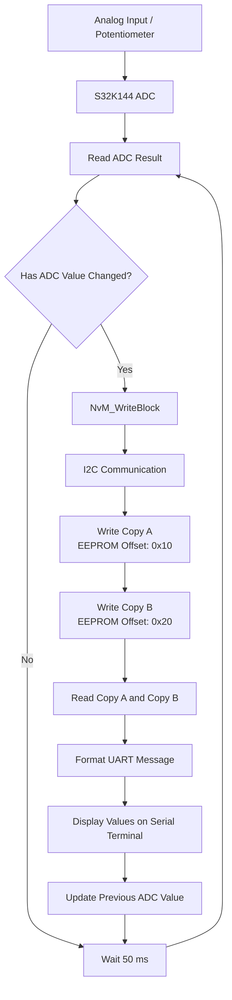

# S32K144 ADC-Based EEPROM Dual-Copy Storage

## 1. Aim

To interface an external I2C EEPROM with the S32K144 microcontroller, read an analog input through the ADC, store the converted value at two separate EEPROM memory offsets using a dual-copy mechanism, and display the ADC value and both stored copies through UART whenever the ADC value changes.

## 2. Project Overview

This project demonstrates ADC data acquisition, I2C-based EEPROM communication, dual-copy storage, and UART monitoring. The microcontroller monitors the ADC result and performs an EEPROM write only when the value differs from the previously processed reading.

## 3. Hardware and Software Requirements

### Hardware

| No. | Component | Purpose |
|---:|---|---|
| 1 | S32K144 development board | Main controller |
| 2 | I2C EEPROM module | Non-volatile data storage |
| 3 | Potentiometer or analog voltage source | ADC input |
| 4 | USB cable | Programming and debugging |
| 5 | UART serial terminal/interface | Output monitoring |

### Software

| Software / Driver | Purpose |
|---|---|
| S32 Design Studio | Development and debugging |
| Putty Software | To verify UART output |

## 4. System Block Diagram


## 5. Theory

### 5.1 Analog-to-Digital Converter (ADC)

An ADC converts an analog voltage into a digital number that can be processed by the microcontroller. In this project, the S32K144 reads the configured ADC result buffer. The application compares the current result with the previously processed value. If the value changes, it initiates the EEPROM storage and UART display operations.

### 5.2 EEPROM

EEPROM stands for Electrically Erasable Programmable Read-Only Memory. It is a non-volatile memory, meaning that data remains stored when power is removed. EEPROM is commonly used for configuration parameters, calibration data, counters, and other information that must persist across resets.

The microcontroller communicates with the external EEPROM over I2C. Two different address concepts are used:

- **I2C slave address:** Identifies the EEPROM device on the bus.
- **EEPROM memory offset:** Identifies a location within the EEPROM where data is stored.

The actual slave address and internal address width must be confirmed from the EEPROM module's datasheet.

### 5.3 Dual-Copy Storage

Dual-copy storage stores the same logical data at two different EEPROM offsets. In this project, Copy A is stored at offset `0x10`, and Copy B is stored at offset `0x20`.

When the block identifier is `1`, the `NvM_WriteBlock()` function writes the ADC value to Copy A and then Copy B. The program subsequently reads both copies for comparison.

Dual-copy storage can help detect inconsistent data and support recovery when combined with integrity checks and a recovery policy. Simply storing two copies does not, by itself, guarantee fault tolerance.

### 5.4 I2C Communication

I2C uses two signal lines:

- **SDA:** Serial data.
- **SCL:** Serial clock.

The controller selects the EEPROM using its I2C slave address, then specifies the internal memory offset for a read or write operation. EEPROM write-cycle timing and page boundaries must be respected.

### 5.5 UART Communication

UART is used to display the current ADC value and the values read from both EEPROM locations. The program formats the values into a string using `sprintf()` and sends the string to a serial terminal through the configured LPUART peripheral.

## 6. Working Principle

1. Initialize the system clock, pins, ADC, I2C, and UART peripherals.
2. Start ADC conversion and obtain the current digital reading.
3. Compare the current reading with the previously processed reading.
4. If the reading has not changed, wait briefly and check again.
5. If the reading has changed, call `NvM_WriteBlock()` with block identifier `1`.
6. Write the ADC value to EEPROM offset `0x10` (Copy A).
7. Write the same value to EEPROM offset `0x20` (Copy B).
8. Read both EEPROM locations into separate variables.
9. Format the ADC and EEPROM values and send them through UART.
10. Update the previous ADC value and repeat.

## 7. Algorithm Flow

```text
START
  |
Initialize clock, pins, ADC, I2C and UART
  |
Start ADC conversion
  |
Read current ADC value
  |
Compare current value with previous value
  |
  +-- Same value --> Wait --> Read ADC again
  |
  +-- Different value
          |
     NvM_WriteBlock(block 1, ADC value)
          |
     Write Copy A at offset 0x10
          |
     Write Copy B at offset 0x20
          |
     Read both copies
          |
     Display values through UART
          |
     Update previous ADC value
          |
         Repeat
```

## 8. How Data Is Stored at an Offset

An offset is an internal memory address within the EEPROM. For example, the project uses:

- `EEPROM_OFFSET_A = 0x10`
- `EEPROM_OFFSET_B = 0x20`

Suppose the ADC reading is `1250` decimal, equivalent to `0x04E2` hexadecimal. If the program stores the 16-bit value in little-endian order, its two bytes are `0xE2` and `0x04`.

| EEPROM offset | First byte | Second byte | Reconstructed value |
|---|---|---|---:|
| `0x10` (Copy A) | `0xE2` | `0x04` | 1250 |
| `0x20` (Copy B) | `0xE2` | `0x04` | 1250 |

This byte example assumes a 16-bit value stored in little-endian order. The code's byte order and the EEPROM's internal address format must be verified for the selected hardware. Some EEPROM devices require a two-byte memory address rather than a one-byte offset.

## 9. Expected UART Output

```text
ADC=1250 CopyA=1250 CopyB=1250
ADC=1280 CopyA=1280 CopyB=1280
ADC=1350 CopyA=1350 CopyB=1350
```

## 10.OUTPUT


## 11. Result

The project demonstrates how to acquire an analog input using the S32K144 ADC, store the resulting digital value at two separate offsets in an external I2C EEPROM, read both copies back, and display the results through UART when the ADC value changes.

Successful operation is confirmed when both copies match the written ADC value, output updates on a change in the ADC result, and data remains available after reset or power cycling.
